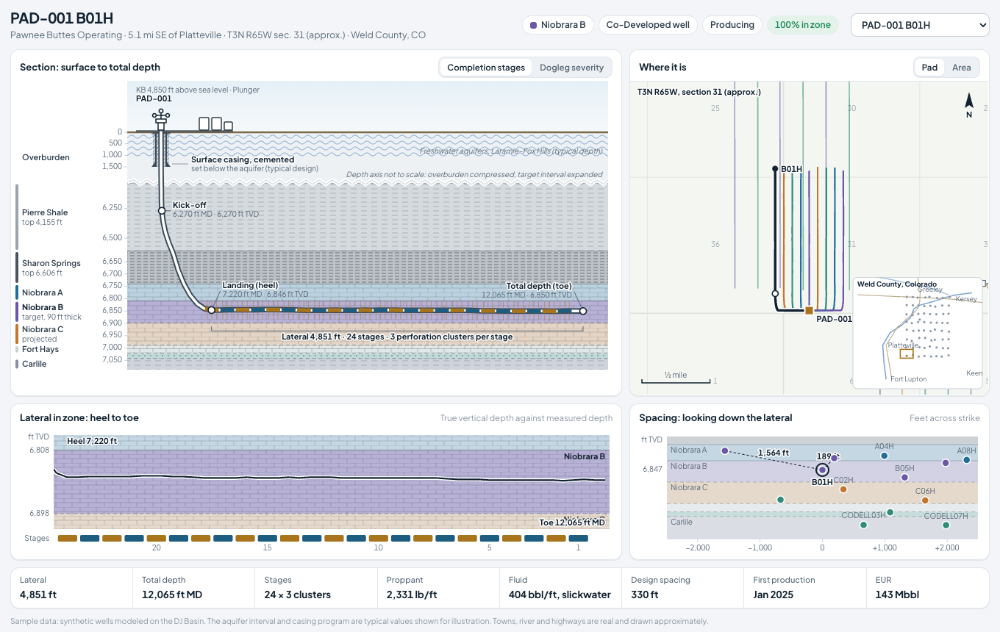

# Wellbore schematic for Sigma

A [Sigma](https://www.sigmacomputing.com) plugin that draws one well from its directional
survey, on live data from your warehouse:

- **Section**: surface to total depth, with the formations, casing, kick-off, landing point
  and the lateral coloured by completion stage or dogleg severity.
- **Lateral in zone**: the lateral against the target formation from heel to toe, and the
  share of it that stayed in zone.
- **Map**: the pad's wells from their surveys, with neighbouring wells around them.
- **Spacing**: looking down the lateral, every nearby well by distance across strike and
  landing depth.

It is wired to a Sigma control in both directions. Picking a well in the schematic sets the
control, and changing the control, or selecting a row in a Sigma table that sets it, redraws
the schematic. Everything else on the page that listens to that control follows.



## Get started

**[Quick start](docs/QUICKSTART.md)**: host the plugin, register it in Sigma, load the sample
data and build the workbook page. About 30 minutes.

To see it without Sigma:

```bash
npm install
```

```bash
npm run dev
```

Then open http://localhost:3220/standalone.

## What it needs from your warehouse

Four tables, in feet and degrees. [`warehouse/schema.sql`](warehouse/schema.sql) has the full
definition with a note on every column, and [`warehouse/sample/`](warehouse/sample) has sample
data for 30 synthetic wells.

| Table | One row per | Needed to draw |
| --- | --- | --- |
| `WELLS` | well | `WELL_ID`, `WELL_NAME`, `SURFACE_LATITUDE`, `SURFACE_LONGITUDE` |
| `DIRECTIONAL_SURVEY` | survey station | `WELL_NAME`, `MD_FT`, `TVD_FT`, `INCLINATION_DEG`; northing and easting offsets for the map |
| `COMPLETION_STAGES` | stage | `WELL_NAME`, `STAGE_NO`, `TOP_MD_FT`, `BASE_MD_FT` |
| `FORMATION_TOPS` | formation top in a well | `WELL_NAME`, `FORMATION_ID`, `FORMATION_NAME`, `STRAT_ORDER`, `TOP_TVD_FT` |

The plugin finds columns by their Sigma display names ("Well Name", "Md Ft"), ignoring case
and punctuation. If your warehouse uses other names, rename the columns in the Sigma table.

## Routes

| Route | What it is |
| --- | --- |
| `/` | The Sigma plugin. This is the URL to register in Sigma. |
| `/standalone` | The same drawing on the sample extract in `public/wellbore`, with its own well picker. `?well=<name>` picks the starting well and `?theme=dark` switches to dark. |

## What is drawn from data and what is illustration

- **From your data:** the well path, kick-off and landing points, stages, formation tops, the
  in-zone figure, well locations, spacing distances and the facts row.
- **Illustration:** the freshwater aquifer interval and the surface casing are typical values,
  not per-well records. Formations below a well's deepest top are projected with a default
  thickness and drawn dashed.
- **Estimated:** a neighbouring well with no survey to hand is placed back from its bottom
  hole by its lateral length, parallel to the selected well.

## Limits to know about

- **Horizontal wells only.** A vertical well shows a message instead of a drawing.
- **Feet and degrees.** There is no metric option yet.
- **Background geography is built in for one area.** For wells in the DJ Basin (Weld County,
  Colorado) the map adds towns, rivers, highways, a locator inset and approximate township and
  section labels. Anywhere else the map shows the wells on a plain one-mile grid.
- **Formation colours** are fixed for the DJ Basin benches. Other target formations get a
  stable colour from a six-colour palette; non-targets are grey.
- **Some tables need their columns picked by hand** in the plugin's panel. The quick start
  covers when and how.
- **Sigma's API cannot place plugin elements**, so the element is added in the workbook editor.

## Project layout

- `app/`: the two routes and the styles.
- `components/wellbore/WellborePlugin.tsx`: Sigma binding, column matching and control wiring.
- `components/wellbore/WellboreApp.tsx`: the standalone page on the sample extract.
- `components/wellbore/WellboreView.tsx`: the view both share. `Section`, `ZoneStrip`,
  `AreaMap` and `Spacing` are the four drawings; `data.ts` holds types and geometry.
- `warehouse/`: the example schema and sample CSVs.
- `public/wellbore/`: the sample extract behind `/standalone` (490 synthetic wells).

Built with Next.js, React and [`@sigmacomputing/plugin`](https://github.com/sigmacomputing/plugin).

## Sample data

Every well, operator name, API number and survey in this repository is synthetic, modeled on
the DJ Basin. It does not describe real wells.

## License

MIT. See [LICENSE](LICENSE).
